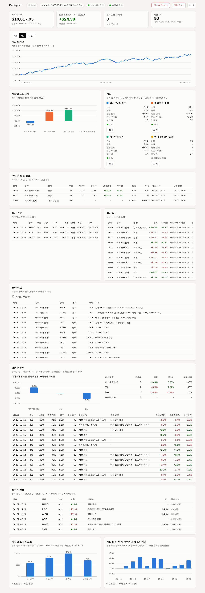

# pennybot — 미국 페니주 자동매매 (토스증권 Open API)

토스증권 데이마켓(한국 낮)에 사서 그날 밤 미국 프리마켓~정규장 개장 직후에 파는 페니주 봇입니다.
전략 계획서: 공유 문서 "미국 페니주 자동매매 전략 계획서".

> ⚠️ 페니주는 변동성·스프레드·거래정지·상장폐지 위험이 매우 큽니다.
> 이 코드는 수익을 보장하지 않으며, 반드시 **모의매매(paper)로 충분히 검증한 뒤** 소액으로 시작하세요.

## 내 컴퓨터에서 실행하기

처음 한 번만 1~7, 그다음부터는 `start.bat` 더블클릭이면 됩니다. (맥은 `.bat` 대신 터미널에서 `bash setup.sh`, `./pennybot.sh`, `./start.sh`)

1. **코드 받기 (git 으로, 권장)**: [Git](https://git-scm.com/download/win) 설치 후 명령 프롬프트에서
   ```
   cd C:\
   git clone -b claude/elegant-galileo-1nmavv https://github.com/nnn999884-alt/lab.git pennybot
   ```
   비공개 저장소라 처음에 GitHub 로그인 창이 뜹니다. 이후 새 버전은 **`update.bat` 더블클릭**이면 받아집니다
   (`.env`, `config.yaml`, `state` 폴더는 그대로 유지).
   - git 없이: [브랜치 페이지](https://github.com/nnn999884-alt/lab/tree/claude/elegant-galileo-1nmavv) → **Code** → **Download ZIP**
     → `C:\pennybot` 처럼 경로에 한글·공백 없는 곳에 풀기 (업데이트 때마다 다시 받아야 함)
2. **파이썬 설치**: <https://www.python.org/downloads/> 에서 3.12 설치. 첫 화면의 **Add python.exe to PATH** 체크.
3. **`setup.bat` 더블클릭**: 패키지를 설치하고 `.env`(비밀값 파일)를 메모장으로 엽니다. 아직 키가 없으면 그냥 닫아도 됩니다.
4. **미리보기 (키 없이)**: 폴더 주소창에 `cmd` 입력 후 Enter → 검은 창에서 `pennybot.bat dashboard --demo`
   → 브라우저로 <http://127.0.0.1:8050> (예시 데이터). 끌 때는 검은 창에서 Ctrl+C.
5. **토스 Open API 키**: 토스증권 **설정 > Open API**에서 발급 ([개발자 문서](https://developers.tossinvest.com/docs)).
   같은 화면 아래 **허용 IP 관리**에 이 컴퓨터의 공인 IP를 등록합니다 (네이버에서 "내 아이피" 검색).
   집 인터넷 IP는 가끔 바뀌니, 나중에 `403` 오류가 나면 다시 등록하세요.
6. **`.env` 채우기** (메모장으로 열기):
   - `TOSS_CLIENT_ID`, `TOSS_CLIENT_SECRET`: 5에서 받은 값
   - `SEC_USER_AGENT`: `pennybot 홍길동 me@example.com` 처럼 이름+이메일 (SEC 공시 조회 규칙)
   - `PENNYBOT_WEBHOOK`: 디스코드 웹훅 주소 (선택, 체결 알림)
7. **계좌·연결 확인**: `pennybot.bat accounts` → 나온 `accountSeq` 숫자를 `.env`의 `TOSS_ACCOUNT`에 → `pennybot.bat check`
   (장 캘린더, 시세, 데이마켓 1분봉이 나오면 정상)
8. **켜기: `start.bat` 더블클릭** → 수집기·매매 봇·대시보드 창 3개가 뜨고 브라우저가 열립니다. 기본은 **모의매매**입니다.
   오류로 꺼지면 30초 뒤 자동으로 다시 켜집니다. 창을 닫으면 그 프로그램이 멈춥니다. 기록은 `state\logs`.
9. **(선택) 휴대폰 알림·원격 제어 — 텔레그램**
   - 텔레그램에서 `@BotFather` → `/newbot` → 받은 토큰을 `.env`의 `PENNYBOT_TELEGRAM_TOKEN`에
   - 방금 만든 내 봇에게 아무 말이나 보낸 뒤 `pennybot.bat telegram-setup` → 나온 숫자를 `PENNYBOT_TELEGRAM_CHAT`에
   - 체결·청산·오류·일일 리포트가 오고, `/상태` `/정지` `/재개` `/청산 확인` `/리포트` 로 조작할 수 있습니다 (내 chat 만 받음)
10. **(선택) 컴퓨터를 켜면 자동 시작**: `autostart_on.bat` 더블클릭 (해제는 `autostart_off.bat`)

- 컴퓨터가 잠들면 멈춥니다: Windows **설정 > 시스템 > 전원**에서 절전을 "안 함"으로. 봇은 한국 오전 9~10시(데이마켓 시작)부터
  다음 날 새벽(정규장 개장 30~60분 뒤)까지 일하고, 수집기는 24시간 켜 두는 게 좋습니다.
- 새 버전 받기: git 으로 받았으면 `update.bat`. ZIP 이면 새로 받아 풀고 예전 폴더의 `.env`, `config.yaml`, `state` 를 복사 → `setup.bat`.
- 실거래는 모의매매로 충분히 확인한 뒤에만: `config.yaml`의 `mode: live` + `.env`의 `PENNYBOT_LIVE_CONFIRM=YES`.

## 지금 단계: 세션별 데이터 수집

전략을 검증하려면 데이마켓·프리·정규·애프터 각 세션의 가격과 호가가 필요합니다.
`python -m pennybot collect`를 24시간 켜 두면 `state/market.db`(SQLite)에 쌓입니다.

| 테이블 | 내용 | 주기 |
| --- | --- | --- |
| `universe` | 토스 거래 가능 종목 중 $0.2~$10 | 하루 1번 |
| `prices` | 유니버스 전체 현재가 | 1분 |
| `quotes` | 감시 종목 최우선 호가·잔량 (빈 호가도 기록) | 1분 |
| `bars_1m` | 감시 종목 1분봉 | 30분 + 세션이 바뀔 때 |
| `rankings` | 시장·토스 거래대금, 급등·급락 상위 | 10분 |
| `filings` | SEC 공시(Form 4·8-K·증자) 접수 시각과 공개된 세션, 내부자 매수 금액, 본문·첨부(EX-99/EX-10) 판정 | 5분 |
| `news` | 보도자료 피드(GlobeNewswire·PR Newswire·Business Wire·Accesswire)에서 `(NASDAQ: XXXX)` 표기로 찾은 기사와 호재/악재 판정 | 2분 |
| `session_summary` | 종목·영업일·세션별 OHLCV, VWAP, 스프레드 중앙값 | 애프터마켓 종료 시 |

모든 행에 `trade_date`(미국 영업일)와 `session`(DAY/PRE/REGULAR/AFTER)이 붙습니다.
데이마켓은 그 영업일 전날 밤(미국 동부 20:00~04:00)이므로, 한 영업일은 데이 → 프리 → 정규 → 애프터 순서입니다.
세션 시각은 토스 장 운영 캘린더 API를 정본으로 씁니다.

```bash
# (직접 설치할 때) setup.bat / setup.sh 가 하는 일
pip install -r requirements.txt
cp config.example.yaml config.yaml
cp .env.example .env            # TOSS_CLIENT_ID / TOSS_CLIENT_SECRET / SEC_USER_AGENT
python -m pennybot accounts     # accountSeq 확인 → .env 의 TOSS_ACCOUNT
python -m pennybot check        # 연결 점검: 장 캘린더, 시세, 1분봉의 세션 분포
python -m pennybot collect      # 수집 시작 (24시간)
python -m pytest
```

토스 API 사용법과 명세에서 확인한 제약은 [docs/toss_api.md](docs/toss_api.md)에 정리했습니다.

## 자동매매: 페니 급등주 세션 매매 엔진

`python -m pennybot trade` (기본 모의매매). 수집기와 같이 돌려야 전략이 후보를 찾습니다.

페니 급등주는 평균적으로 장중에 되밀리고, 급등 직후 회사가 주식을 파는(증자) 일이 많습니다.
그래서 **밤사이만 들고 개장 무렵 개인 매수세에 팔고**, **지금 주식을 팔 수 없는 회사만 고릅니다.**

| 전략 | 내용 |
| --- | --- |
| 러너 오버나이트 | 전날 +30% 이상, 고가권 마감, 거래 회전 큼, 희석 위험 낮음 → 데이마켓 매수 → 프리마켓 후반~개장 30분 내 매도 |
| 희석 해소 촉매 | ATM 종료 · 증자 등록 철회 · 공모 철회 · 자사주 매입 공시 → 데이마켓 매수 → 프리마켓~개장 매도 |
| 데이마켓 점화 | 아시아 시간에 새 호재 공시(내부자 매수, 증자 무관 계약)나 토스 거래대금 상위로 막 움직이는 종목 → 미국 군중보다 먼저 |
| 데이마켓 급락 반등 | 기본 꺼짐 (페니주 급락은 증자·펌프 붕괴인 경우가 많음) |

**희석 분석** (`pennybot/dilution.py`, SEC_USER_AGENT 필요)
- 공시 본문을 읽어 사건을 방향과 함께 판정: ATM 신규/종료, 등록 직접 공모, 공모, 사모, 증권매매계약, 주식 매수 약정,
  워런트 행사가 인하·행사 유도, 전환사채, 액면병합, 증자 등록(S-3)·효력·철회, 자사주 매입, 상장 요건 회복
- 8-K 1.01(중요 계약)은 본문에 증권매매계약·공모 문구가 있으면 악재로 판정 (페니주에서는 대부분 증자 계약)
- 증자 설명서의 "이 공모는 ~하면 종료된다" 같은 상투 문구는 ATM 종료로 보지 않음 (수시 공시의 실제 종료 문장만)
- 8-K/6-K 는 첨부도 읽음: 보도자료(EX-99)는 호재·악재 모두, 계약서(EX-10)는 악재만 (계약서 해지 조항을 ATM 종료로 오인하지 않게)
- 회사별 희석 위험 점수(0~100): ATM 진행, 유효한 증자 등록과 남은 한도(유통 시총 7,500만$ 미만은 12개월에 1/3까지),
  최근 증자, 전환사채·워런트, 액면병합, 공모 신고서 → 가점 / ATM 종료·철회·자사주 → 감점
- 재무(XBRL): 현금 ÷ 월 영업현금 소진 = **현금 런웨이** (3개월 미만이면 곧 증자) · **미행사 워런트**가 발행주식의 20% 이상이고
  행사가가 현재가 근처면 가점 (오르면 워런트 행사 물량이 나옴)
- 보도자료: 공모 가격 결정·상장 요건 미달·계속기업 불확실성 → 악재, FDA 승인·수주·ATM 종료 → 호재. 공시보다 먼저 나오는 경우가 많음

**펌프 위험 신호** (FINRA 공지 22-25 근사): 상장 1년 이내, 해외 발행사, 발행주식 1,500만 주 미만, 촉매 없는 급등 — 3개 이상이면 제외

**공통 장치**

| 기능 | 내용 |
| --- | --- |
| 매수 | 데이마켓에서만, 종료 30분 전까지. 스프레드가 좁으면 ask, 넓으면 중간가 근처 지정가. 5분 미체결 시 취소 |
| 매도 | 강제 청산 시각 > 보유 중 악재(공시·보도자료) > 손절 > 트레일링 > 익절 > 매도 시작 시각 순. 재호가는 **가격 정정**(토스는 정정·취소마다 새 주문번호 → 줄기로 추적), 최종은 bid −5% 지정가, 호가가 아예 없을 때만 시장가 |
| 분할 익절 | 러너: 익절가(+12%)에서 **절반** 매도 → 나머지는 손절을 본전으로 올리고 **고점 대비 −8% 트레일링**, 강제 청산 시각(개장 30분 뒤)까지 |
| 세션 전환 | 세션이 바뀌면 걸린 주문 모두 취소 (토스 DAY 주문은 정규장까지 이어지므로) |
| 수량 | 손절폭이 아니라 **밤사이 최악의 갭**(러너 35%) 기준으로 손실이 계좌 1%를 넘지 않게. 종목당 계좌 5%·$300 상한 |
| 리스크 | 전략별 예산, 동시 보유 8, 영업일 손실 $150, 같은 종목 하루 1회, 최근 20회 평균 손익 음수면 전략 자동 정지 |
| 시장 상태 | 데이마켓 중 IWM이 전일 대비 −1.5% 이하면 신규 매수 중단 |
| 운영 | 킬스위치·전량 청산·전략 켜기/끄기, 재시작 시 열린 주문 복구, 잔고 대조, 웹훅 알림 |
| 모의매매 | 실제 토스 호가에 대해 보수적으로 체결 (ask/bid 기준, 최우선 잔량까지만) |
| 실시간 | 토스 웹소켓으로 보유·후보 종목 호가·체결, 내 주문 이벤트(실거래). 이벤트 온 주문만 즉시 조회, 끊기면 자동으로 REST 폴링 |
| **서버 손절 안전망** | 보유 중에는 토스 **조건주문**(미국 주식은 모든 세션에서 발동)으로 봇 손절가 3% 아래에 매도를 걸어 둠. **PC·봇이 꺼져도 토스 서버가 손절**. 발동되면 봇이 그 주문을 이어받아 기록 |
| 수수료·한도 | 토스 수수료율을 조회해 손익에 반영(순손익 기준으로 손실 한도·전략 자동 정지 판단). 최근 7일 손실 한도, 4연속 손실이면 24시간 쉼 |
| 매수 유의 차단 | 토스 매수 유의사항(VI 발동·투자경고·정리매매 등)이 걸린 종목은 사지 않음 |
| 주문 안전 | 정정·취소마다 새 주문번호인 토스 방식을 줄기로 추적(거부된 정정·취소, 응답 유실 시 실제 주문 찾기 포함), 새 주문은 멱등키로 중복 없이 재시도 |
| 장애 대응 | 장 캘린더 조회 실패 시 평일 근사로 계속 청산, 재시작 시 멈춘 매매 상태 복구·모르는 주문 알림, 잔고 불일치 알림(봇 기록이 더 많으면 신규 매수 중단), 매도 거부 반복 시 쉬었다가 재시도, 수집기 멈춤 알림 |
| 알림·원격 | 디스코드/슬랙 웹훅, 텔레그램(명령 지원), 같은 오류는 30분에 한 번만 |
| **일일 리포트** | 영업일이 끝나면 **한국 시간 07:30**에 알림 (`daily_report_time_kst`로 변경). 그날 매매(진입→청산 세션, 순손익, 사유), 전략별 성적, 7일·30일·전체 누적, 평가액 변화, 후보 수·주요 탈락 사유, 미청산·잔고 불일치 경고. 그 시각에 봇이 꺼져 있었으면 켜질 때 보냄. `state/reports/`에 저장, 대시보드 **일일 리포트**에서 날짜별로, 텔레그램 `/리포트 2026-10-21` |

수집기는 매일 애프터마켓이 끝나면 급등주(+30%)를 희석 점수·펌프 신호와 함께 `runners` 테이블에 기록합니다.
대시보드의 **급등주 추적**에서 희석 위험별로 다음 날 수익률을 비교해, 이 가설이 맞는지 확인할 수 있습니다.

실거래는 `config.yaml`의 `mode: live`와 환경변수 `PENNYBOT_LIVE_CONFIRM=YES`가 둘 다 있어야 합니다.

## 백테스트 (리플레이)

```bash
python -m pennybot backtest                                   # 수집기 DB 전체 기간
python -m pennybot backtest --start 2026-11-02 --end 2026-11-27 --param runner_overnight.trail_pct=6
```

수집기 DB(`state/market.db`)를 1분 간격으로 다시 흘려 **실제 매매 엔진을 그대로** 돌립니다 (토스 API 접속 없음).
- 재생 시각까지의 데이터만 보임: 공시·보도자료·가격 흐름·랭킹·유니버스 모두 as-of 로 잘림 (미래 데이터 차단)
- 체결: 그 시각의 수집 호가 기준. 호가 기록이 없으면 현재가 ±0.75%, 잔량 1,000주로 보수적 가정
- 수수료 0.1% (`--fee`) 반영 순손익, **학습(앞 70%) / 검증(뒤 30%) 구간**을 나눠 과최적화 확인
- 결과는 `state/backtests/<시각>/report.json` + `backtest.db`, 대시보드 **백테스트** 칸에서 비교
- `--with-edgar`: 희석 프로필까지 (제출일 ≤ 재생일만 써서 미래 공시는 안 섞임, 네트워크 필요)

수집을 시작한 날부터만 데이터가 있으므로, 최소 몇 주 쌓인 뒤에 의미가 있습니다 (거래 30건 미만이면 경고).

## 대시보드

`python -m pennybot dashboard` → <http://127.0.0.1:8050>. `--demo`를 붙이면 예시 데이터로 미리 볼 수 있습니다.



계좌 평가액 추이, 전략별 손익과 켜기/끄기, 보유 종목과 손절·익절·청산 시각, 주문·청산 기록, 전략 후보와 탈락 사유,
급등주 추적(희석 위험별 다음 날 흐름), 공시·보도자료 이벤트(호재/악재 판정), 백테스트 결과, 세션별 호가 확보율(데이마켓 유동성),
주목 종목의 개장 프리미엄 점검을 보여줍니다.
내 컴퓨터(127.0.0.1)에서만 열리고 토스 API는 부르지 않습니다.

## 24시간 돌리기

```bash
python -m pennybot collect     # 터미널 1: 데이터 수집
python -m pennybot trade       # 터미널 2: 매매 (모의)
python -m pennybot dashboard   # 터미널 3: 대시보드
```

## (구) Coil & Catalyst 스크리너와 장중 매매 루프

아래는 이전 계획의 코드입니다. 며칠 보유를 전제로 해서 지금 계획(데이마켓 매수 → 당일 밤 매도)과
맞지 않습니다. 희석 필터와 공시 파싱(`screener/edgar.py`)은 새 전략에서 다시 씁니다.

### Coil & Catalyst — 남들과 다른 점

| | 일반적인 페니주 스캐너 | Coil & Catalyst |
|---|---|---|
| 언제 찾나 | 장중, 이미 +20~50% 오른 뒤 | 전날 밤, 오르기 전 |
| 무엇을 보나 | 상승률·거래량 순위 | 변동성 수축 + 조용한 매집 + 박스 상단 근접 |
| 공시 | 안 봄 (뉴스 헤드라인 정도) | SEC 공시로 **희석·상폐 위험 종목 차단**, 내부자 장내매수 가점 |
| 군중 | 군중과 같은 종목 | 5일 +50% 넘게 오른 종목은 일부러 제외 |
| 기준값 | 고정 숫자 | 그날 후보군 안에서의 **상대 순위(백분위)** |

**1단계: 응축 점수 (일봉, 0~100)**
- `atr_ratio`: 10일 ATR / 60일 ATR이 낮을수록 좋음 (스프링이 눌린 정도)
- `tightness`: 최근 15일 박스 폭
- `vol_trend`: 가격은 횡보하는데 거래량이 늘어나는지 (10일 / 60일)
- `obv_net`: 20일 동안 상승일 거래량에서 하락일 거래량을 뺀 비율 (몰래 사는 쪽이 있는지)
- `clv`: 종가가 일중 고가 쪽에서 끝나는지 (매도 물량을 누가 받아내는지)
- `dist_to_pivot`: 20일 고점(피벗)에 얼마나 가까운지, 저점이 높아지고 있으면 +5

**2단계: 공시 레이어 (SEC EDGAR, 무료)**. 응축 상위 60개만 조회합니다.
- 차단: 30일 이내 증자 공시(424B·S-1·S-3·F-1·F-3), 상장폐지 통지(8-K 3.01), 정기보고서 지연(NT 10-K/Q)
- 감점: 90일 이내 증자 공시 −25, 사모 증자(8-K 3.02) −15, 정관 변경/액면병합(8-K 5.03) −10
- 가점: 내부자 장내매수(Form 4 코드 P, 금액 비례) 최대 +20, 13D 지분 취득 +8, 중요 계약(8-K 1.01) +3

**3단계: 장중 진입 (피벗 돌파)**
- 현재가가 피벗 위에 있고, 1분봉 종가로 돌파가 확인될 것
- 당일 누적 거래량이 평소 페이스(20일 평균 × 경과시간 비율)의 2배 이상
- 피벗보다 5% 넘게 올랐으면 추격 금지, 피벗 −3%를 이탈하면 돌파 실패로 보고 손절

모든 후보의 팩터 값은 `state/screens/날짜.csv`에 쌓입니다. 이 데이터로 나중에
**어떤 팩터가 실제로 수익을 냈는지** 검증하고 가중치(`screener.weights`)를 조정할 수 있습니다.

### 구조

```
pennybot/
  toss_api.py       토스 Open API 저수준 클라이언트 (토큰 공유, 그룹별 한도, 에러 envelope)
  sessions.py       세션 판정 (토스 장 캘린더 기준, 데이/프리/정규/애프터)
  collector/        세션별 데이터 수집기 (runner.py) + SQLite 저장소 (store.py)
  brokers/toss.py   Broker 인터페이스 ↔ 토스 API 어댑터
  brokers/paper.py  모의 브로커 (실제 주문 없음)
  data.py           토스 키 없이 쓰는 공개 시세 피드 (Yahoo)
  screener/         Coil & Catalyst 스크리너
    factors.py      일봉 응축 팩터 (순수 함수)
    scorer.py       하드필터 + 백분위 점수
    edgar.py        SEC 공시 파싱: 희석 방패 / 촉매 / Form 4 내부자 매수
  strategy.py       피벗 돌파(스크리너 종목) / 갭업 ORB(수동 종목) 진입, 청산 규칙
  risk.py           포지션 크기 / 일일 손실한도 / 거래횟수 / 킬스위치
  engine.py         매매 루프 (지정가 주문 → 15초 미체결 시 취소)
```

### 시작하기

```bash
pip install -r requirements.txt
cp config.example.yaml config.yaml   # 감시종목, 전략/리스크 값 수정
cp .env.example .env                 # 토스 API 키 입력
python -m pytest                     # 테스트
python -m pennybot screen            # 장 전 스크리닝 → state/watchlist.json
python -m pennybot run -v            # 모의매매 실행 (장중에만 동작)
python -m pennybot run --once -v     # 한 번만 실행해서 동작 확인
```

### 토스증권 연결

1. 토스증권 앱/웹에서 **Open API 신청** → `client_id`, `client_secret` 발급
2. `.env` 에 `TOSS_CLIENT_ID`, `TOSS_CLIENT_SECRET`, `TOSS_ACCOUNT`(accountSeq) 입력
3. 엔드포인트와 필드는 공식 명세 v1.2.17 기준으로 `toss_api.py` / `brokers/toss.py` 에 구현돼 있습니다
4. 키가 있으면 `mode: paper` 에서도 토스 시세로 모의매매합니다 → 시세·잔고 조회가 정상인지 먼저 확인
5. 실거래: `mode: live` + 환경변수 `PENNYBOT_LIVE_CONFIRM=YES` (둘 다 있어야 실제 주문)

### 안전장치

- 지정가 주문만 사용 (매수 ask+0.5%, 매도 bid−1% 상한), 스프레드 2% 초과 종목 제외
- 종목당 최대 $200, 최대 3종목, 일일 손실 $100 도달 시 신규진입 중단
- 손절 시 손실이 남은 일일한도의 절반을 넘지 않도록 수량 제한
- 15:00(ET) 이후 신규진입 금지, 15:50 전량 청산 — 오버나이트 보유 없음
- 당일 청산한 종목 재진입 금지, 돌파 후 +5% 넘게 오른 종목 추격 금지
- `state/KILL` 파일을 만들면 즉시 신규진입 중단 (`touch state/KILL`)

### 하루 흐름

1. 전날 밤이나 장 전: `python -m pennybot screen`. 처음 실행하면 전 종목 일봉을 받느라 오래 걸리고, 같은 날 다시 돌리면 캐시를 씁니다.
   전 종목 대신 일부만 보려면 `screener.universe_file`에 종목을 한 줄에 하나씩 적으세요.
2. 장중: `python -m pennybot run`. `watchlist: auto`면 스크리너 결과를 점수 순으로 감시합니다.
3. 주말: `state/screens/*.csv`와 매매 결과를 비교해서 팩터 가중치를 조정합니다.
